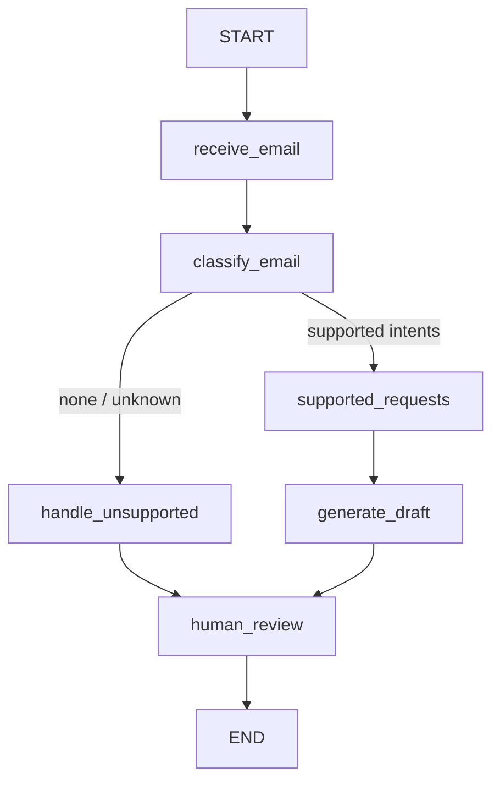

# Architecture & Design

Covers: solution architecture, low-level design, API specifications, agent workflow, assumptions and limitations.

## 1. Solution architecture

```text
 Customer email: POST /emails/process (text)
        or  Gmail inbox over IMAP ── POST /emails/mailbox/poll (or background poller)
        or  .eml files in data/inbox ── POST /emails/inbox/poll
              │ email reader: parse, clean text, save + read attachments (PDF / image OCR)
          │
          ▼
 FastAPI (apis/email_api.py) ── resolves sender → customer_id (403 if unknown)
          │                     saves record in email.db
          ▼
 LangGraph workflow (agents/email_workflow.py)  ── checkpoints in email_checkpoints.db
          │
          ├─ LLM (Llama 3.2 via Ollama): intents, sentiment, dates, count (intents are checked against keywords)
          │
          ├─ MCP client ──stdio──▶ MCP server (agents/mcp_server.py) ──▶ banking.db
          │                        validate_*, get_*, request_account_statement
          │
          ├─ Reply template (utils/reply_builder.py): fixed wording, no LLM
          │
          └─ Human review (interrupt) ── POST /emails/{id}/review resumes the graph
                 └─ approved → reply sent over SMTP, threaded under the customer's message
```

| Layer | Technology | Where |
|---|---|---|
| API | FastAPI | `main.py`, `apis/` |
| Orchestration | LangGraph + SQLite checkpointer | `agents/email_workflow.py` |
| LLM | Llama 3.2 3B via Ollama (`OLLAMA_MODEL` to change) | `utils/llm_client.py` |
| Tool layer | MCP (stdio) | `agents/mcp_server.py` |
| Core banking (mock) | SQLite | `utils/database.py`, `apis/banking_api.py` |
| Real mailbox | IMAP + SMTP (stdlib `imaplib` / `smtplib`), Gmail App Password | `utils/mailbox.py` |
| Email reader / attachments | stdlib `email`, pypdf, Tesseract (pytesseract) | `utils/email_reader.py` |
| Audit / masking | stdlib `logging` | `utils/logging_config.py` |

Design choices:
- **The LLM never touches banking data and never writes the reply.** It only classifies the email. Banking data is fetched by tools, and the reply is built from a fixed template, so names, amounts and numbers cannot be invented or garbled (the 1B model once greeted a customer with their masked account number).
- **Customer identity comes from the backend** (sender email → `customers` table), never from the email text. Every tool re-checks ownership.
- **Account and card numbers are extracted by regex**, not the LLM; small models are unreliable at digits. The LLM output for dates and count is validated before use.
- **Numbers in logs and replies are masked** (`XXXX7890`); the finished draft is masked again as a last guard.
- **Attachments are supporting evidence only.** Their text can fill in a missing account/card number but never creates an intent (intents come from the email body), and any number found is still validated for ownership.
- **Nothing is sent without human approval.** The workflow ends at a human-reviewed draft; only an approval triggers the SMTP reply.

## 2. Agent workflow



| Node | Responsibility | Writes to state |
|---|---|---|
| `receive_email` | Trim and reject empty input | `email_text`, `status` |
| `classify_email` | Intents, sentiment, entities (one LLM call in JSON-only mode, plus regex and a date parser) | `intents`, `sentiment`, `entities` |
| route (`route_request`) | Allow-list check on intents | – |
| `supported_requests` | Per intent: pick account/card → validate → call tool. One failure does not stop the others | `tool_results`, `errors`, `status` |
| `handle_unsupported` | Hand-off draft (`build_handoff_reply`: apology/urgency line if needed, "unable to complete this request automatically", then `SUPPORT_CONTACT_TEXT`); no tool calls. Goes to `human_review` like any other draft, flagged **Needs a person** in the console | `draft` |
| `generate_draft` | Builds the reply from verified results with a fixed template (greeting uses the name from the validation tools; Indian-style amounts, e.g. `INR 1,25,000.00`); canned fallback if building fails | `draft`, `customer_name` |
| `human_review` | `interrupt()` until a reviewer approves, edits or rejects | `approval_status`, `draft` |

Workflow statuses: `invalid_input`, `classified`, `banking_data_retrieved`, `partial_success`, `failed`, `draft_generated`, `draft_generation_failed`, `unsupported`, `approved`, `rejected`. API-level: `pending_review`, `processed`.

Supported intents: `check_balance`, `get_transactions`, `request_statement`. Multiple intents in one email are all executed and consolidated into a single draft.

Execution order: customer account/card discovery runs first; then all intents run **in parallel**, and within one intent the number is **validated before** data is fetched. Each tool call has a 15 s timeout (`TOOL_TIMEOUT_SECONDS`). Read-only tools are retried once on timeout; `request_account_statement` is never retried because it writes a row. A timeout is reported to the customer as "the banking service did not respond in time" and audited as `tool_timeout`.

Sentiment handling: the template adds one fixed line: `negative` → an apology, `urgent` → "We understand that this is urgent.", `positive` → a thank-you. No line promises escalation, callbacks, compensation or timelines. `negative` and `urgent` emails get `priority: "high"` (shown to the reviewer in the review request, stored on the record, returned by `GET /emails/{id}`, and written to the audit log), so reviewers can handle them first.

Partial failure (Scenario 5): an invalid card produces an error such as *"The card number provided could not be validated. Please recheck the card details and resend your request."* The account balance still succeeds, the status is `partial_success`, and the draft reports both.

## 3. Low-level design

**Intent guard:** the LLM may over-report intents (the earlier 1B model added `get_transactions` to a balance-only email), so an intent is kept only if the email contains one of its words (balance/funds; transaction/purchase/spend/payment/activity/card; statement).

**State** (`models/email_state.py`, Pydantic, `extra="forbid"`):
`email_text`, `intents`, `sentiment`, `entities`, `tool_results`, `draft`, `errors`, `status`, `approval_status`, `reviewer_feedback`, `sender_email`, `verified_customer_id`.

**Entities** (`entities` dict): `account_number`, `card_number` (regex), `start_date`, `end_date` (ISO; found in the email by `utils/periods.py`, with the LLM's dates only as a validated fallback), `transaction_count` (1–10), `customer_name`.

**Access control and the console:** every `/emails` endpoint requires the `X-Reviewer-Token` header when `REVIEWER_TOKEN` is set (constant-time comparison; shown as *Authorize* in Swagger), because approving sends real email. With the variable unset the API is open and the server logs a warning at startup. `/ui` and `/health` are reachable without it; the page contains no data and its API calls need the token, which the reviewer types in and which is kept in `sessionStorage` only. The page renders all email and draft text with `textContent`, never as HTML, and a test fails the build if `innerHTML`-style APIs are added. The mock banking API under `/api` is not covered by this token.

**Review guard:** `POST /emails/{id}/review` resumes the saved LangGraph run only if it is really paused for review; if its checkpoint is missing it answers 409 instead of silently re-running the workflow from scratch and overwriting the record. The console (`ui/index.html`, vanilla JavaScript, no build step) auto-opens the most urgent pending email, splits the draft into Subject and Message, confirms before sending, shows server errors as messages, supports `#email_id` deep links, and has been checked in a real browser (desktop, phone width, dark mode, and a hostile email containing HTML/script that must render as plain text).

**Real mailbox** (`utils/mailbox.py`, `apis/email_api.py`): unread mail from the last `MAIL_MAX_AGE_DAYS` days (default 2; keeps the agent away from an old backlog) is fetched newest first with `BODY.PEEK[]` (up to 10 per poll), processed, then marked read. Messages are marked read even if processing failed, so a bad message is not retried forever (the failure is in the audit log and `email.db`). Per message, in order: skip automated mail (`Auto-Submitted`, `Precedence: bulk`, mailer-daemon / no-reply) and the agent's own address; **reject senders Gmail did not authenticate** (only the `mx.google.com` `Authentication-Results` header is trusted, and DKIM/SPF must pass for the From domain; `REQUIRE_SENDER_AUTH=false` disables this for testing only); skip a `Message-ID` already stored; then the normal pipeline. After approval, `_deliver` sends the final draft to the recorded sender with `In-Reply-To`/`References`, `Auto-Submitted: auto-replied` and a single-line subject (the draft's `Subject:` line, else `Re: <original>`). Delivery state is stored as `delivery_status` (`sent`, `send_failed`, `not_configured`, `no_recipient`, `not_sent`); a send failure never undoes the approval.

**Email reader** (`utils/email_reader.py`): parses `.eml` (sender, subject, body; HTML-only bodies are stripped to text), cleans the body (drops quoted lines, `On … wrote:` threads and signatures) and prepends the subject. Attachments (PDF, image; max 10 MB each) are saved to `data/attachments/<email_id>/` (names sanitised) and read: PDFs with pypdf, images with Tesseract OCR. A corrupt, oversized, unsupported or unreadable attachment is skipped and audited (`attachment_skipped`) and never fails the email. Attachments are only handled after the sender is verified.

**Selecting the account/card for an intent:** use the number in the email if present; otherwise use the customer's only active account/card; otherwise record "not specified". A statement also needs both dates.

**MCP tools** (`agents/mcp_server.py`):

| Tool | Purpose |
|---|---|
| `get_customer_accounts`, `get_customer_cards` | Active accounts/cards owned by the customer |
| `validate_account`, `validate_card` | `VALID` / `INVALID` (another customer's number is `INVALID`) |
| `get_account_balance` | Balance, ownership-checked |
| `get_card_transactions` | Latest N transactions, ownership-checked |
| `request_account_statement` | Creates a statement request, returns a reference |

**Databases** (SQLite, in `DATA_DIR`, default the project root; a Docker volume in Docker; a temp folder in tests):
- `banking.db`: `customers`, `accounts`, `cards`, `transactions`, `statement_requests`
- `email.db`: `email_records` (one row per email: status, intents, sentiment, tool results, draft, errors, review info; older databases are migrated automatically)
- `email_checkpoints.db`: LangGraph checkpoints, which let a paused review survive a restart

**Logging and audit** (`utils/logging_config.py`):
- `logs/app.log` + console: application logs, passed through a masking filter.
- `logs/audit.log`: one JSON line per event, keyed by `email_id`: `email_received`, `classified`, `tool_call` (tool, masked arguments, duration), `requests_finished`, `draft_generated`, `human_review`, `email_failed`.
- Masking keeps the last 4 digits of long numbers and leaves money amounts alone.

## 4. API specifications

### Email API

| Method & path | Purpose |
|---|---|
| `POST /emails/process` | Submit an email; runs the workflow until the draft is ready for review |
| `GET /emails?status=pending_review&limit=50` | Work queue: recent emails (optionally one status) with id, subject, sender, priority, created time; high priority first, then oldest first |
| `GET /emails/{email_id}` | Current state: status, intents, sentiment, priority, draft, errors, review info |
| `POST /emails/{email_id}/review` | Approve / edit / reject the draft and resume the workflow |
| `POST /emails/mailbox/poll` | Read unread mail from the configured Gmail account and process it (503 if not configured). Also runs in the background when `MAIL_POLL_SECONDS` > 0. The response includes the IMAP search used (`searched`) and, when nothing matched, a `note` saying how many unread messages from other senders were ignored |
| `POST /emails/inbox/poll` | Process every `.eml` file in the simulated mailbox `data/inbox`; handled files move to `processed/`, rejected ones to `failed/` |
| `GET /ui` | Reviewer console: a single static page (`ui/index.html`) that calls the endpoints above |
| `GET /health` | Liveness |

`POST /emails/process`
```json
{ "email_text": "Please provide my balance for account 1234567890.",
  "sender_email": "demo@example.com" }
```
→ `200`
```json
{ "email_id": "<uuid>", "status": "pending_review",
  "message": "Email processed and draft is waiting for human review." }
```
Errors: `403` unknown sender, `500` workflow failure.

`POST /emails/{email_id}/review`
```json
{ "approved": true, "feedback": "OK", "edited_draft": null }
```
→ `200 { "email_id": "...", "status": "approved", "message": "Draft approved." }`
Errors: `404` unknown email, `409` not awaiting review, `400` edited draft with a rejection.

### Mock core banking API (`/api`, header `X-Demo-Customer-ID`)

| Method & path | Purpose |
|---|---|
| `GET /api/accounts/{account_reference}/balance` | Account balance |
| `GET /api/cards/{card_reference}/transactions?limit=N` | Card transactions (1–10) |
| `POST /api/accounts/{account_reference}/statements?start_date=&end_date=` | Request a statement |
| `POST /api/accounts/validate` | `{"account_number": "..."}` → `{"status": "VALID", "customer_name": "..."}` |
| `POST /api/cards/validate` | `{"card_number": "..."}` → `{"status": "INVALID"}` |

Interactive docs: `http://localhost:8000/docs`.

## 5. Assumptions and limitations

**Assumptions**
- Core banking is mocked in SQLite; the demo customer is `CUST001` (`demo@example.com`, account `1234567890`, card `4567XXXX8901`).
- Sender email is trusted as supplied by an upstream ingestion layer (no real authentication).
- A human approves every draft; the system never sends mail.

**Not implemented yet**
- A single shared token, not user accounts: no per-reviewer identity or audit of who approved (the audit log records the decision, not the person).
- Mailbox polling is by interval, not IMAP IDLE push. Only plain-text replies are sent (no HTML or attachments). Gmail address aliases (dots, `+tags`) are not normalised when matching the customer.
- Any approved email with a recorded sender is replied to when SMTP is configured, including emails submitted through `POST /emails/process`.
- Attachments are not summarised or understood, only searched for an account/card number. OCR needs Tesseract (installed in the Docker image; on a dev machine it must be installed separately, otherwise image attachments are skipped).
- Sentiment drives tone and a review priority flag only; there is no automatic escalation or routing queue.
- No language detection / multi-language, confidence scoring, RAG policy lookup or dashboard.
- `receive_email` flags an empty email but the graph still continues to classification.

**Known limitations**
- `llama3.2:3b` is small; the original `1b` was weaker still. Intent and date accuracy has not been measured; use a larger Llama model for production.
- A statement needs a period the parser understands: month and year ("April 2026", "04/2026"), "last month" / "this month", a month name after for/of/in ("for March" = the most recent March), or two dates (day-first, e.g. "01/04/2026 to 30/04/2026"). Anything else, or a period in the future, makes the system ask the customer. Quarters, financial years ("FY 2025-26") and "last N months" are not recognised; the current month is cut off at today.
- `email.db` stores the original email text unmasked (needed for review), and saved attachments in `data/attachments/` are the original files.
- Whole-number amounts of 6+ digits in a draft could be masked as if they were account numbers.
