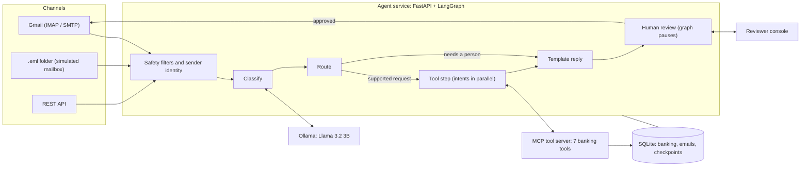

# Case Study: A Human-Supervised Agentic AI for Banking Email

How we designed, built and tested an AI assistant that reads customer emails, fetches the answers from a banking system and drafts replies, with a person approving every reply. It follows the usual layers of an agentic AI system (model, agent pattern, tool calling, memory, state, retrieval, context, security, reliability, deployment). For each one it says what we built and why, what we deliberately did **not** build, and how to defend that choice.

Companion documents: [DESIGN_AND_DECISIONS.md](DESIGN_AND_DECISIONS.md) (the 26 numbered decisions, D1-D26, referred to below), [ARCHITECTURE.md](ARCHITECTURE.md) (specs), [CLIENT_GUIDE.md](CLIENT_GUIDE.md) (demo), [INTERVIEW_PREP.md](INTERVIEW_PREP.md) (concepts).

**How to use this document.** Sections 1-4 are the story. Section 5 is the substance: one subsection per layer, each in the same shape (*Built / Why / Evidence / Not built, and the defence / Next step*). Section 10 is the "why didn't you…?" cheat-sheet. Section 12 turns it into a presentation.

---

## 1. Summary

| | |
|---|---|
| **The task** | Build an AI system for a financial institution that handles customer emails (balance, card transactions, statements, several requests in one email), validates the details, calls banking APIs, copes with partial failure and writes professional replies. |
| **What we built** | A pilot-grade assistant. A local Llama model understands each email; ordinary code does everything exact (identity, numbers, dates, the reply text); a small set of banking tools fetches the data; **a person approves every reply before it is sent**. It works against a real Gmail inbox, with a web console for reviewers, and runs with one `docker compose up`. |
| **The approach in one line** | *Use the model only to understand text; use plain, testable code wherever a wrong answer costs money or trust.* |
| **Evidence** | 130 automated tests; a browser test of the console; live runs against the real model, a real Gmail account and the Docker stack; about 7.4 s from arrival to a draft ready for review (6.3 s of it the model) and about 480 emails/hour per worker (section 5.13) on a laptop CPU. |
| **Honest status** | Pilot-ready for three request types. **Not measured:** accuracy on real customer email. **Simulated:** the core-banking data. **Prototype-level:** scale, per-user access control, monitoring (section 6). |

---

## 2. The brief and what shaped the design

The client's task asked for: understand email, detect intent and sentiment, extract account/card details (from the email and attachments), validate them, decide which APIs to call, fetch from mock banking APIs, handle multiple requests and partial failure, generate professional replies, orchestrate with an agentic workflow, and document it, using Python, an LLM (Llama) and an agent framework.

Constraints that drove the decisions:

| Constraint | Consequence |
|---|---|
| It is a **bank**: wrong or leaked figures are costly | Facts come from tools, never from the model; human approval; masking; audit trail. |
| Customer data is sensitive | Local open model (Llama via Ollama); nothing sent to an external AI service. |
| Banking systems are **mocked** | Tools are a clean seam; swapping in real APIs doesn't touch the rest. |
| The task is a **prototype/pilot**, not a production rollout | Choose the simplest part that is safe and demonstrable; document the path to production instead of building all of it. |
| Accuracy of a small local model is limited | Constrain it (JSON mode, allow-lists), check it with code, and keep a human in the loop. |

---

## 3. The solution at a glance

| Layer | Technology |
|---|---|
| Language model | Llama 3.2 3B through Ollama (local), JSON-only output |
| Orchestration | LangGraph state machine with an SQLite checkpointer |
| Tools | MCP server (7 tools) over stdio; a REST mirror of the same functions |
| API and console | FastAPI; one static HTML page (vanilla JavaScript) |
| Mail | IMAP / SMTP (Gmail), Python `email` library; PDF via `pypdf`, images via Tesseract OCR |
| Data | SQLite (banking, email records, graph checkpoints) |
| Packaging | Docker Compose: `ollama`, a one-shot `ollama-pull`, and `api` |

---

## 4. Design principles (the "why" behind everything)

1. **Model for meaning, code for exactness.** Intent and mood need language understanding; account numbers, dates, amounts and wording need to be right every time.
2. **Never trust, always verify.** Not the sender, not the model, not the attachment, not the number in the email.
3. **A human approves anything that leaves the building.** Autonomy is a dial we turn up with evidence, not a default.
4. **Fail safe, and say so.** When unsure, ask the customer or hand to a person. Never guess a period, an account or a name.
5. **Everything is recorded, and nothing sensitive is.** Full audit trail, masked numbers.
6. **Keep seams clean.** Model, tools, data, mail and UI are separate so each can be replaced.

---

## 5. The layers, one by one

### 5.1 Model

**Built.** Llama 3.2 **3B** (Ollama tag `llama3.2:3b`), local, used for exactly one job: read one cleaned email and return JSON with `intents`, `sentiment`, and optional `start_date`, `end_date`, `transaction_count`, `customer_name`. Ollama's **JSON mode** (`format="json"`) forces valid JSON. The model name is a setting (`OLLAMA_MODEL`).

**Model selection record (D1, D2).**

| Option | Verdict |
|---|---|
| Hosted frontier model | Most accurate and easiest, but customer email would leave the bank's environment. Rejected on privacy. |
| Llama 3.2 **1B** local | Tried first. Added intents nobody asked for, and when it wrote the reply it greeted a customer with their masked account number. Rejected. |
| Llama 3.2 **3B** local (chosen) | Behaved reliably on our scenarios once surrounded by code; about 2 GB download; roughly 4 GB RAM is sensible. |

**Where the model's output is *not* trusted.** Intents must be in a 3-item allow-list and the email must contain a matching word (keyword guard). Account and card numbers come from regex. Statement periods come from a deterministic parser. The reply is a template. Chatty output is decoded defensively (first valid JSON object).

**Evidence.** On the real model: "statement for April 2026", which the model alone had failed to turn into dates, resolved correctly on every real-model run after the date parser was added; a balance-only email no longer pulled in an extra transactions lookup (the guard dropped the model's wrong intents); JSON mode cut classification from about 20-27 s to about 5-9 s because the model writes far less.

**Not built, and the defence**

| Not built | Why that's defensible | Next step |
|---|---|---|
| Accuracy evaluation on real email | We have no real, labelled mail for this task. What we *can* show is that a wrong model answer is caught by code or by the reviewer. | Label a few hundred real emails; measure precision/recall/F1 per intent; set an acceptance threshold. First pilot task. |
| Confidence scores | Ollama JSON mode gives no probabilities; the human reviewer is the safety net. | Self-consistency (ask twice), or token log-probabilities; send low confidence to "Needs a person". |
| Fine-tuning, model routing/cascade, a second fallback model | No labelled data; one small model with guards was enough for the scope. | Fine-tune or cascade only once a labelled set shows where the small model fails. |
| Schema-constrained output | We use `format="json"`, not a JSON schema. Our own validation does the schema check. | Pass a JSON schema to Ollama's `format` parameter. |

---

**Closed in Phase 0 (after the first version of this document).** The model call is now **deterministic** (`temperature` 0, fixed `seed`), **bounded** (a 120 s timeout, `OLLAMA_TIMEOUT_SECONDS`; on timeout the email goes to the review queue as "Needs a person"), has an **explicit context window** (`num_ctx` 4096) and is **kept warm** (`keep_alive` 30 min). Evidence: across two rounds of the same 8 emails, the model returned identical classifications. A small side-effect of testing against the real model: it sometimes writes the *word* "null" as a name instead of a JSON null; such placeholders are now ignored.

### 5.2 Agent pattern

**Built.** A **workflow with an LLM router and a human-in-the-loop**, not an autonomous agent. In the common taxonomy of agent patterns we use *routing* (classify, then branch), *parallelization* (all intents of one email run concurrently) and *human-in-the-loop* (the graph pauses for approval). We do **not** use orchestrator-workers, an evaluator-optimizer (self-critique) loop, or open-ended tool-using loops.

The graph (`agents/email_workflow.py`): `receive_email → classify_email → [route] → supported_requests → generate_draft → human_review`, or `→ handle_unsupported → human_review`.

**Why (D6).** A bank needs a flow it can inspect, test and audit. Free-roaming agents decide their own next step, which makes behaviour harder to predict and prove safe. The brief's list of "agents" (understanding, intent, sentiment, entities, validation, API selection, response, audit) maps onto nodes and functions with the same responsibilities.

**The autonomy ladder (a useful way to describe it to a client).**

| Level | Meaning | Status |
|---|---|---|
| 1. Suggest | The system drafts; a person does everything else | Passed |
| 2. **Act with approval** | The system prepares the full reply and sends only after approval | **We are here** |
| 3. Act within limits | Auto-send for narrow, low-risk cases (e.g. a plain balance reply, no complaint), with sampling | Next, once accuracy is measured |
| 4. Act autonomously | Broad automation | Not recommended for a bank without long track record |

**Not built, and the defence**

| Not built | Defence |
|---|---|
| Multi-agent collaboration | The steps are single-purpose and sequential; splitting them into autonomous agents would add non-determinism and cost with no benefit for three request types. |
| Self-critique / reflection loop | The reviewer is the evaluator, and it is stronger than the same small model checking itself. |
| Dynamic planning | The set of actions is fixed and small; planning would add risk without need. Adding an intent is six well-defined steps (design document, section 9). |

---

### 5.3 Tool calling

**Built.** Seven tools exposed over **MCP** (stdio): `get_account_balance`, `get_card_transactions`, `request_account_statement`, `get_customer_accounts`, `get_customer_cards`, `validate_account`, `validate_card`. Properties:

- **Code decides which tool to call** from the validated classification; the model does not pick tools or arguments (D7).
- **Validate, then fetch**, per intent. An invalid or not-owned number never reaches a data call.
- **Ownership is checked inside every tool** using the verified `customer_id`. A number belonging to someone else returns `INVALID`, so its existence is not revealed.
- **Discovery:** the client lists the server's tools and refuses to run if a required one is missing.
- **Independent intents run in parallel** (`asyncio.gather`); **timeouts** of 15 s per call; **one retry for read-only calls**, none for the statement request, which writes a row (D10, D11).
- Results are converted into **customer-safe messages** (e.g. "The card number provided could not be validated. Please recheck…"), so a failure in one tool never blocks the others.
- A REST version of the same functions exists as the documented API contract (D13).

**Evidence.** Tests cover valid/invalid/partial cases, parallel ordering, timeouts and retries (including the "statement is never retried" rule), and ownership.

**Not built, and the defence**

| Not built | Defence |
|---|---|
| Model-chosen tool calls (function calling), multi-step tool loops | For three fixed request types, the correct tool is a function of the intent. Letting the model choose adds a failure mode and a manipulation surface (prompt injection) for no gain. |
| Authentication between client and tool server | They are parent and child process on one host over stdio. With a networked tool server this becomes mandatory (mTLS or tokens). |
| Tool-server pooling | One short-lived server per email is simple and isolated; the start-up cost is irrelevant at pilot volume. Pool for scale. |
| Circuit breaker / rate limits on tools | Timeouts and retries cover transient faults; add breakers when the tools are real remote services. |

---

### 5.4 Memory

**Built.** Memory in this system is deliberately small and explicit.

| Kind | What we have |
|---|---|
| **Working memory** (during one run) | The graph state: the email, extracted entities, tool results, draft. |
| **Durable run memory** | LangGraph **checkpoints** in SQLite (so a paused review survives a restart) and the `email_records` table (a permanent record of each email, its outcome and delivery). |
| **Idempotency memory** | The `Message-ID` of every processed mail, so nothing is processed twice. |
| **Audit memory** | The JSON audit log (what happened, in order, per email). |
| **Reviewer feedback** | Stored with each record (`reviewer_feedback`, approval status). |

**Not built, and the defence**

| Not built | Defence |
|---|---|
| Conversation or customer-history memory | Each request in scope (balance, transactions, statement) is self-contained. Quoted history is **removed on purpose**: it shrinks the prompt, and old text could carry instructions we do not want the model to see. |
| Semantic / long-term memory (vector store of past interactions) | Nothing in the task needs it, and storing customer content for retrieval raises retention and privacy duties that the task did not ask us to take on. |
| A feedback loop (learning from edits and rejections) | The data is collected (approval, edits, notes) but not yet used. Next step: measure the "approved unchanged / edited / rejected" rates, and use edits as labelled data. |

---

### 5.5 State

**Built.** One typed state object (`EmailState`, Pydantic): `email_text`, `attachment_text`, `intents`, `sentiment`, `entities`, `tool_results`, `draft`, `errors`, `status`, `approval_status`, `reviewer_feedback`, `sender_email`, `verified_customer_id`, `customer_name`. Each node returns only the fields it changes; there are no custom reducers, so a returned field replaces the old value (which is why error lists are rebuilt, not appended).

- **Persistent:** the checkpointer saves state keyed by `thread_id = email_id`.
- **Status machine:** received → classified → (tools) → draft ready → **pending review** → approved / rejected; with `delivery_status` (`sent`, `send_failed`, `not_configured`, `no_recipient`, `not_sent`) tracked separately.
- **Two stores, one truth to protect:** the graph checkpoint and the email record can disagree if one is lost. The review endpoint therefore checks the graph is *really paused* before resuming, otherwise it answers 409 (found by a browser test; without it a review silently re-ran the workflow and overwrote the record).
- **A LangGraph subtlety we handled:** on resume, the paused node re-runs from the top, so anything with side effects belongs *before* the pausing node (the "draft generated" audit event does).

**Not built, and the defence:** optimistic locking/versioning for two reviewers acting on one email (the 409 guard closes most of the race), event sourcing, and checkpoint-schema versioning. Reasonable for a single-reviewer pilot; add versioning before multi-reviewer use.

---

### 5.6 RAG (retrieval-augmented generation): **not implemented, by design**

**What we did instead.** *Structured retrieval through tools.* The facts a customer asks for (their balance, their transactions) are per-customer, exact and permission-controlled, and they live in a system of record. We retrieve them with typed, ownership-checked tools, then put them into a template. That is grounding without embeddings.

**Why not RAG (the defence).**
1. **Nothing in the task needs documents.** RAG helps answer questions from unstructured knowledge (policies, product terms). The task asked for account, card and statement data.
2. **RAG is approximate.** Similarity search can return the wrong passage; for balances and transactions an approximate step in the path is a liability.
3. **Permissions.** Vector stores don't know which customer may see what. Our tools do.
4. **Fewer moving parts** to secure, evaluate and run.
5. The brief listed RAG as an *optional enhancement*.

**How we would add it (the seam exists).** A `search_policy` tool on the MCP server returning cited passages from an approved document set (vector index such as FAISS or pgvector); the reply may state only what the retrieved text says and must quote its source; the reviewer sees the sources; retrieval is evaluated separately (hit rate, answer faithfulness); document updates are versioned.

---

### 5.7 Context management

**Built.** The model sees very little, on purpose.

- **The prompt** contains the instructions and **one cleaned email** (subject plus body). No history, no tool results (the reply is a template), no attachment text.
- **Cleaning** (`utils/email_reader.py`): quoted replies, "On … wrote:" threads and signatures are removed; HTML-only mail is turned into text.
- **Attachments are kept out of the prompt** (D4): their text is used only to find a missing account or card number by regex. That also closes a prompt-injection path (a document cannot add an intent).
- **Exact fields are extracted from the *full* text by code**, so even if the model's input were cut short, account numbers, card numbers and statement periods are still found.
- **Size limits:** the REST endpoint caps an email at 20,000 characters; attachments at 10 MB (text capped at 20,000 characters, not sent to the model).

**Not built, and the defence**

| Not built | Defence |
|---|---|
| Summarising long threads, token counting, chunking | Not needed for single-request emails; the first pilot week's data will say if long threads exist. |

**Closed in Phase 0:** the model now sees at most the first 6,000 characters of an email (`MAX_EMAIL_CHARS`; a warning is logged when text is cut) and the context window is set explicitly (`OLLAMA_NUM_CTX`, 4096). Exact fields are still extracted from the full text, which a test proves (a number placed after the cut is still found).

---

### 5.8 Human oversight

**Built.** Every reply goes through review. The console shows the customer's email beside an editable reply (separate Subject and Message), chips for the request type and mood, an **Urgent** flag (negative or urgent sentiment, or fraud/lost-card wording), a **Needs a person** flag for anything the system cannot complete, a yellow box listing what it could not do, a confirmation showing exactly what will be sent and to whom, and a History tab. Requests we cannot do (an address change) and fraud reports are **never auto-answered**: they go to a person with a hand-off draft that uses the client's own support wording (`SUPPORT_CONTACT_TEXT`) (D25, D26).

**Not built, and the defence:** dual control for high-risk replies, sampling reviews of approved replies, and review-quality metrics. A single reviewer is enough for a pilot; the data needed for the metrics is already recorded.

---

### 5.9 Security

**Threat model and controls (what is built)**

| Threat | Control |
|---|---|
| Someone asks for another customer's data | Identity comes from the **verified sender**, never from the email body; every tool checks ownership (IDOR defence); invalid and not-owned look the same. |
| Forged `From` address | Only answer senders whose domain **Gmail itself authenticated** (DKIM or SPF pass, aligned with the From domain). A header added by the sender is ignored (D15). |
| Prompt injection via the email or an attachment | Email wrapped as data; output restricted to an allow-list; attachment text can never create an intent; tools enforce ownership regardless of what the model said. |
| Unauthorised approval and sending | A shared reviewer token on every `/emails` endpoint (constant-time comparison, kept only in the browser tab); the server warns at start-up if it is unset (D19). |
| Script injection into the reviewer's browser | Customer text rendered with `textContent` only; a test fails the build if `innerHTML`-style APIs appear; a browser test uses a hostile email. |
| Header injection in outgoing mail | Subjects forced to one line. |
| Malicious attachment names or sizes | Names reduced to a safe base name; 10 MB cap; only PDF and images read. |
| Leaking sensitive numbers | Last four digits only in logs, audit and replies (D20). |
| Reply loops and spam | Skip bounces, no-reply, `Auto-Submitted`/bulk mail and our own address; our replies are marked `Auto-Submitted`. |
| A backlog or other people's mail being touched | Unread only, last N days, newest first, optional sender allow-list, `PEEK` fetch (D16). |
| Secrets in the repository or image | `.env` git-ignored and Docker-ignored; App Password only in `.env`. |

**Not built, and the defence**

| Not built | Defence | Next step |
|---|---|---|
| Per-user accounts / SSO; recording *who* approved | One shared token is the minimum honest control for a pilot; the audit log records the decision, not the person. | SSO and an `approved_by` field. |
| TLS termination, secrets manager | The service is run locally or behind the client's network; TLS belongs to the deployment layer. | Reverse proxy with TLS; vault. |
| Encryption at rest; retention and deletion policy | The raw email is kept in `email.db` for review; a policy is a client decision. | Encrypt the volume; define retention. |
| Rate limiting / abuse protection | The mailbox path is already bounded (10 per poll); the API is not public. | Gateway rate limits. |
| Gmail OAuth instead of an App Password | An App Password is simpler to demonstrate, but it grants full mailbox access. | OAuth with minimal scopes. |
| Tamper-evident audit log | The log is append-only by convention. | Ship to write-once storage. |

---

**Closed in Phase 0.** The console now ships with a strict **Content-Security-Policy** using a fresh random nonce per request (`default-src 'none'`; only the page's own script and style run; no framing; no outside images; `nosniff`, `no-referrer`, `no-store`). It was verified in a real browser: the page works normally, and injected inline script, an outside image and a framed page were all blocked. The container now **runs as an unprivileged user** (uid 10001): an entrypoint takes ownership of the data, log and attachment folders (including volumes created earlier by the root container) and then drops privileges with `gosu`. A log folder that cannot be written no longer stops start-up; audit lines then go to the console instead of being lost.

### 5.10 Reliability

**Built**

| Failure | Behaviour |
|---|---|
| Model down or malformed answer | No intents, no banking call; the email goes to review as "Needs a person" with the error shown. |
| One request in an email fails | Others succeed (partial success); the customer is told what to fix. |
| Tool slow | 15 s timeout, one retry for reads, then a customer-safe message. |
| Statement request | Never retried automatically (no duplicate writes). |
| Attachment unreadable | Skipped and audited; the email still processes. |
| Sending fails | Approval stands; `delivery_status = send_failed`; shown to the reviewer. |
| Same mail twice | Detected by `Message-ID`. |
| Two polls at once | Serialised by a lock. |
| Server restarts mid-review | Nothing lost: state is checkpointed. |
| Review of an email with no saved workflow | Refused with 409; nothing overwritten. |

**Evidence.** Tests for each of the above; the live runs; and several real defects that testing found and we fixed (section 9).

**Not built, and the defence**

| Not built | Defence | Next step |
|---|---|---|
| A work queue, dead-letter queue and back-pressure | Polling is bounded (10 per poll) and single-process; volume is a pilot volume. | A queue with workers and retries. |
| Circuit breakers; LLM call retries | Failure of the model already degrades safely to a human. | Add with the LLM timeout. |
| Readiness checks and live alerts | `/health` is liveness only (it does not check the model or mailbox); Compose uses it as the container health check. Per-email traces, per-step timings and the latency report exist (sections 5.13, 5.14), but nothing pages anyone. | Readiness endpoint; alert rules. |
| SLOs, backups, disaster recovery | Out of scope for a task at this stage. | Define with the client. |

---

### 5.11 Evaluation and quality

**Built.** 130 automated tests in 13 test files, with the model, IMAP and SMTP faked and throw-away databases: parser cases (including ambiguous ones), reply template, masking, validation and partial failure, timeouts and retries, review flow, mailbox safety rules, token protection, the hand-off path, and an XSS guard. A browser test (driven Edge: desktop, phone width, dark mode, a hostile email). Live runs on the real model.

**What the tests do *not* prove:** how often the *model's* answer is right on real mail. The suite proves that, given a model answer, the system behaves correctly.

**Proposed evaluation plan (to quote to the client).**
1. Collect a few hundred real, anonymised emails; label the correct intents, sentiment and fields.
2. Run them through the system; compute precision, recall and F1 per intent, a confusion matrix, and date/number extraction accuracy.
3. Weight errors by cost: a **false positive** (acting on a request nobody made) is worse than a miss.
4. Set an acceptance threshold per intent; re-run on every model or prompt change.
5. In the pilot, track reviewer outcomes: approved unchanged, edited, rejected, and reasons.

---

### 5.12 Deployment and operations

**Built**

- **Docker Compose** with three services: `ollama` (with a health check), `ollama-pull` (one-shot, downloads the model, then exits) and `api` (starts only after the pull succeeded, using `depends_on` with `service_healthy` / `service_completed_successfully`).
- **Named volumes** for models and databases (`ollama_models`, `app_data`), so rebuilds don't lose data; `./logs` mounted for the logs.
- **Configuration through environment variables** (`.env` / `env_file`): mail credentials, model name, reviewer token, support wording, polling interval, sender allow-list, data directory (the "twelve-factor" approach).
- Image includes Tesseract; dependencies pinned in `requirements.txt`; `.dockerignore` keeps `.env`, databases, logs and internal documents out of the image.
- Start-up behaviour: creates and migrates the databases; warns if the token is unset; optional background mailbox poller.
- Local-run alternative (`uv`) and helper scripts (mailbox check, customer registration, demo, sample inbox).
- Logging: console and rotating files, plus the JSON audit log.

**Not built, and the defence (production path)**

| Production concern | Status | Path |
|---|---|---|
| CI/CD pipeline, image registry, image scanning | Not built | GitHub Actions: tests, build, scan, push. |
| Orchestration (Kubernetes), autoscaling, rolling deploys | Not built; Compose is the pilot unit | Helm chart; stateless API replicas; separate model service. |
| Reverse proxy, TLS | Not built | Ingress with TLS. |
| GPU or hosted inference; resource limits | CPU only; no limits set | Dedicated inference node; memory and CPU limits. |
| Managed database, backups | SQLite | PostgreSQL with backups and migrations. |
| Secrets manager | `.env` file | Vault / cloud secrets. |
| Monitoring, dashboards, alerting, log shipping | Console shows the work queue, not system health | Metrics, traces, alerts; ship audit logs. |
| Environments (dev/test/prod), infrastructure as code | Not built | Terraform plus per-environment config. |

---

**Closed in Phase 0.** Non-root container with an ownership-fixing entrypoint; an API **health check** in Compose (the service reports `healthy`); and **eight unused packages removed** (`langchain`, `langchain-anthropic`, `langchain-openai`, `faker`, `pandas`, `pyarrow`, `psycopg2-binary`, `ipython`, plus a duplicate `dotenv` shim), shrinking `requirements.txt` from 344 to 255 lines.

### 5.13 Latency and throughput

**How it was measured.** The real pipeline (real Llama 3.2 3B, real banking tools over MCP, real OCR) in the Docker container on a Windows laptop, **CPU only, no GPU**, one Ollama container, against a throw-away database. One cold start, then 16 warm emails run one after another (8 kinds, 2 rounds), then concurrency runs. The system also records its own timings: each stage writes its duration to the audit log, and `scripts/latency_report.py` turns that into a table (p50, p95, max per step), so the figures can be re-measured on any machine, including the client's.

**Where the time goes for one email** (warm, medians):

| Step | Time | Notes |
|---|---|---|
| Fetch from Gmail | IMAP connect + login 2.3 s, search 0.7 s, **once per poll** | Network round trips shared by up to 10 messages. |
| Safety filters, identity lookup, record creation | negligible | Single database lookups; not timed separately. |
| Attachments | PDF text about 1 ms; image OCR about 110 ms | OCR measured on a small image; large scans take longer (not measured). |
| **Classification (language model)** | **6.3 s** (range 5.0-9.4 s) | **84% of the machine time. The bottleneck.** |
| Banking tools (whole step) | 1.5 s | Each tool call takes **2-10 ms**; the rest is starting the tool-server process (one per email, decision D7). |
| Reply template | under 1 ms | Effectively free. |
| **Machine total, arrival to draft ready** | **7.4 s median** (5.0-11.1 s; p95 about 9.3 s) | Emails that end as "Needs a person" are faster (5-6 s): no tool step. |
| Human review | not machine time | Whatever the reviewer takes. |
| Send the reply | SMTP connect + STARTTLS + login 2.0 s, plus the send | The send itself was not measured: no mail was sent during the test. |

By kind of email (end to end, warm): balance 7.0-7.2 s; balance + transactions 7.7-8.2 s; bad card 7.9 s; statement 8.8-9.3 s; angry customer 8.1-11.1 s; address change 5.0-5.2 s; fraud 6.2-6.3 s; statement without a period 7.0 s.

**Cold start.** The first email after the model server restarts took **19.9 s** (classification 18.4 s): about 12 s to load the model. `keep_alive` keeps it resident for 30 minutes, so only the first email after a restart or a long idle pays this. Warm it up before a demo.

**Throughput.**

| Measure | Result |
|---|---|
| One worker, emails one after another | **8.0 emails/min, about 480 emails/hour** |
| 8 emails, sequential | 64.0 s |
| 8 emails, 2 at a time | 63.1 s (speed-up x1.01) |
| 8 emails, 4 at a time | 55.4 s (speed-up x1.15) |

**Concurrency barely helps**, because the single CPU-bound model process serves one request at a time and the cores are shared. The model is the throughput limit; adding threads on the same machine does not raise it. To go faster you need faster or more model servers (below), not more parallelism in our code.

**The real bottleneck is the human.** If a reviewer takes 30-60 s per email (an **assumption**, not measured), one reviewer clears 60-120 emails an hour, so the machine side (480 an hour) would keep roughly 4-8 reviewers busy. At pilot volumes the system is limited by review capacity, not by the AI.

**What the client can expect (say it this way).** "Once an email is picked up, a draft is ready in about 7 seconds, 10 at worst in our tests; the first email after a long idle takes about 20 seconds while the model loads. How soon it is *picked up* depends on how often the mailbox is checked (one click, or an interval such as 60 seconds). A reviewer then takes however long the review takes."

**Levers, in order of effect**

| Lever | Expected effect | Status |
|---|---|---|
| Faster inference (GPU, or a smaller or quantised model) | Attacks the 84%; a large reduction is expected, to be measured | Not done |
| One long-lived tool server instead of one per email | Saves about 1.5 s of 7.4 s (about 20%) | Not done (decision D7 revisit) |
| Several model servers behind a queue | Throughput scales roughly with the number of servers | Not done |
| Keep the model warm | Removes about 12 s from the first email | **Done** (`keep_alive`) |
| Shorter prompt / shorter output | Little left to gain: JSON mode already cut classification from about 20-27 s to about 6 s | **Done** |
| Reply drafting, banking tools | Already in milliseconds | Nothing to optimise |

**Not measured:** GPU speed, large-scan OCR, the SMTP send itself, memory use, behaviour under many simultaneous reviewers, and accuracy (a different question from speed).

**Reproduce:** process some emails, then `docker compose exec api python scripts/latency_report.py`.

### 5.14 Observability and tracing

**Built.** Every email is one **trace** (OpenTelemetry, with the OpenInference attribute names LLM tools understand): `email.process` contains `agent.classify` (which contains the `llm.chat` span), `agent.tools` (one `tool.<name>` span per call, arguments masked) and `agent.draft`. The review is a second trace, `email.review`, in the **same session** as the email it belongs to, and `email.send` and `mailbox.poll` are spans too. The model span records the model name, prompt and completion **token counts** and, from Ollama itself, **load, prompt-evaluation and generation time**. Audit-log lines carry the trace id, so a log line and its trace can be matched.

**What it showed on a real run** (5 emails and 3 reviews against the real model; 44 spans in 8 traces):
- **The cold start is visible and explained:** `llm.load_ms` 38.7 s of a 55.4 s model call. That is the first email after a restart, and it is why the p99 latency was 55 s while the median was 8.6 s.
- **Where each warm second goes:** `agent.classify` 7-9 s (all of it the model's generation), `agent.tools` about 1.7 s, every tool call 3-17 ms, `agent.draft` about 0 ms. It confirms section 5.13 from a second source.
- **Model over-reporting is now a number:** `classify.dropped_intents` records every intent the model asked for that the email never mentioned.
- **The reviewer's decision is a quality signal:** `review.edit_similarity` was 1.0 for a draft approved as written and 0.26 for one the reviewer rewrote. The share of drafts approved unchanged over time is the first honest measure of reply quality we will have.

**Why Phoenix and not LangSmith (D31, D32).** LangSmith is a cloud service. Turning it on would send each email's text, account numbers and tool results to a third party, which is the opposite of why the model runs locally. Phoenix is open source, runs as one container on the same machine, and speaks OpenTelemetry. Because we emit standard OpenTelemetry, the client can still choose LangSmith or Langfuse (including their self-hosted editions) by changing two environment variables, and we guard the one case where LangGraph would send data to LangSmith on its own.

**Privacy by default.** Off unless an endpoint is set; metadata only; prompt and answer text only with `TRACE_CONTENT=true`, and then masked; Phoenix published to `127.0.0.1` only. We verified that no raw account or card number appears anywhere in what Phoenix stored, even with content capture on. We also verified that tracing cannot hurt the service: with the viewer unreachable, five emails were processed normally and no slower (1.3-1.6 s each with tracing on against 1.5-2.0 s with it off, model stubbed), and shutdown waits at most about 4 s to flush (the export timeout is 3 s).

**Not built, and the defence**

| Not built | Defence | Next step |
|---|---|---|
| LangSmith and Langfuse tested as targets | They need accounts, and both are cloud services (a data-policy question for the client first). The traces are standard OpenTelemetry. | Test against the client's chosen backend. |
| Alerts, dashboards of system health | Phoenix shows latency, volume and errors, but nothing pages anyone. | Alert rules (latency, error rate, queue length). |
| Automated evaluations (LLM-as-judge, labelled datasets) | The reviewer's edit signal is a stronger, human-grounded measure for now. | Add a labelled set (section 5.11) and run it from the trace viewer. |
| Login for the trace viewer | It is published to the local machine only. | Put it behind the client's authentication before sharing it. |
| Sampling, retention policy | All traces are kept; fine at pilot volume. | Sample and expire for production. |
| Prompt versioning | The prompt lives in code, versioned by git. | Record the prompt version on the span. |

## 6. Production-readiness scorecard

| Dimension | Status | Notes |
|---|---|---|
| Functional scope (3 request types, multi-intent, partial failure, attachments, sentiment) | **Pilot-ready** | Covers the brief's scenarios. |
| Human oversight and safe sending | **Pilot-ready** | Mandatory approval; hand-off path; urgent flags. |
| Security (application level) | **Strong for a pilot** | Identity, ownership, anti-spoofing, masking, XSS defence. |
| Security (platform level) | **Prototype** | No per-user auth, TLS or encryption at rest. The console has a strict CSP and the container is non-root. |
| Reliability | **Good for a pilot** | Timeouts, safe failure, idempotency; no queue or breakers. |
| Observability | **Good for a pilot** | Per-email traces (model tokens and timings, tools, reviewer edits) in a self-hosted viewer, the audit trail with trace ids, and a latency report. No alerts. |
| Model quality evidence | **Not yet** | Logic tested; accuracy unmeasured. |
| Scalability | **Not yet** | Single process, SQLite, CPU inference. |
| Deployment | **Demo/pilot** | Compose; no CI/CD or managed environment. |
| Compliance (retention, consent, residency) | **Not started** | Data stays local; policies are the client's to define. |

---

## 7. Coverage against the brief

| Brief requirement | Status |
|---|---|
| Read and clean email text | Done (quote/signature/HTML cleaning) |
| Intent detection incl. multi-intent | Done (LLM + allow-list + keyword guard) |
| Sentiment (neutral / positive / negative / urgent) | Done; drives tone line and review priority |
| Entity extraction (account, card, dates, count, name) | Done (regex + parser + validated LLM fields) |
| Download and read attachments (PDF, images) | Done; scanned PDFs not read |
| Validate extracted data | Done (validate tools, ownership) |
| API decision engine: which APIs, order, parallelism | Done (validate before fetch; intents in parallel) |
| Mock core APIs (balance, card transactions, statement, validate account/card) | Done (REST and MCP) |
| Professional replies, partial success/failure, clarification requests | Done (template) |
| Error handling: invalid number, API failure, timeout, missing details, unsupported | Done |
| Non-functional: security (mask data), auditability, extensibility | Done |
| Non-functional: scalability, accuracy, performance | Performance good (seconds); scalability and accuracy are *roadmap* items |
| Agentic orchestration | Done (LangGraph) |
| Real email integration | Done (IMAP/SMTP) beyond the "can be simulated" assumption |
| Documentation, README, tests, sample emails, logging, config | Done |
| Optional: OCR, human-in-the-loop | Done |
| Optional: multi-language, RAG, confidence scoring, omnichannel, monitoring dashboard | Not done (sections 5.1, 5.6, 11) |
| Suggested stack: LangChain/LlamaIndex, FAISS, PostgreSQL/MongoDB, CrewAI | Deliberately not used (design document, section 10) |
| Suggested folder layout (`prompts/`, `workflows/`, `config/`) | Not used: prompts live beside their code, configuration is by environment variables |

---

## 8. Results (what we actually measured)

| Measure | Result |
|---|---|
| Automated tests | 130 passing, repeatable |
| Classification time (3B model, laptop CPU, in Docker, JSON mode, warm) | 6.3 s median (about 20-27 s before JSON mode); cold start about 18 s |
| Arrival to draft ready (machine time) | 7.4 s median, 5.0-11.1 s; about 480 emails/hour on one worker |
| Concurrency | 2 at a time x1.01, 4 at a time x1.15: the model is the limit (section 5.13) |
| Tool calls | a few milliseconds each (recorded in the audit log) |
| Model size | about 2 GB |
| End-to-end live loop | Real Gmail in, review in the console, real reply out, threaded under the customer's email |
| Real-model checks | "April 2026", "last month" and explicit date ranges resolved correctly; a plain statement request correctly asked for the period; the address-change email was classified as out of scope (the model's two spurious intents were removed by the keyword guard); a fraud email was handed to a person instead of being answered with data |
| **Not measured** | Accuracy on real customer mail; throughput under load; cost per email at scale |

---

## 9. What went wrong, and what it taught us

The most credible part of a case study. Each of these was found by testing and fixed.

| What happened | Lesson | Change |
|---|---|---|
| A draft greeted "Dear XXXX7890" | Don't let a probabilistic model write facts. | Template reply. |
| A balance-only email also fetched card transactions | Small models over-report. | Keyword guard. |
| "April 2026" produced "period not specified" | Models are poor at date arithmetic. | Deterministic parser. |
| A valid request fell back to "unsupported" intermittently | The model wrapped its JSON in prose with stray braces. | JSON mode and first-object decoding. |
| Audit IDs were sometimes altered | Masking regex hit digits inside UUIDs. | Mask stand-alone numbers only. |
| The first test inbox had 42,784 unread messages | Never touch data you didn't mean to. | Recent-only, newest-first, allow-list, `PEEK`. |
| Reviewing an email with no saved workflow re-ran it and overwrote the record | Verify state before resuming. | 409 guard. |
| A fraud report got a transactions table | Some categories must never be automated. | Urgent words hand the email to a person. |
| Tests failed after registering a real customer | Tests must not share real data or read real credentials. | Throw-away databases; mail settings cleared in tests. |
| Pasting another email link in the same tab kept the old email | Single-page state needs to follow the URL. | `hashchange` handler. |
| The model returned the word "null" (as text) as a customer name | Small models mimic the shape of the answer, not its meaning. | Placeholder names are ignored. |
| A plain "run as non-root" would have locked the app out of its own database volume (created earlier by the root container) | Check what changing the user does to existing data. | An entrypoint takes ownership of the folders, then drops privileges; verified against the live volume. |
| Our own latency report said the median of 1 to 10 is 6 | A test on the reporting tool caught it. | Nearest-rank percentile. |

---

## 10. The defence guide: "why didn't you…?"

Use the shape **scope, reason, seam, next step**: *what the task asked for, why leaving it out is safe, where it would plug in, and how you'd do it.* Be direct about the genuine gaps; say them first.

| Question | Answer |
|---|---|
| **Why no RAG?** | The task is about each customer's own account data: exact, structured and permission-controlled. RAG is approximate and unaware of permissions, and the brief listed it as optional. Grounding is done by tools plus a template. A `search_policy` tool is the seam for policy questions. |
| **Why no vector database or long-term memory?** | No requirement needs it, and storing customer content for retrieval adds privacy and retention obligations. State and records are durable; each request is self-contained. |
| **Why isn't this a "real" agent? Why not let the model choose tools?** | For three fixed request types the right tool follows from the intent. Model-chosen tools add a failure mode and an injection surface. We chose bounded autonomy with a human approving; autonomy can rise per intent as evidence grows. |
| **Why a small local model, not GPT-class?** | Customer email must stay inside the bank; no per-call cost. We compensate with constrained output, guards, exact code for numbers and dates, and review. The model is a setting if the client accepts a hosted one. |
| **How accurate is it?** | We haven't measured it on real mail, because we don't have a labelled set. What we show is that errors are caught (guards) or visible (review). The first pilot task is to measure it, and section 5.11 sets out how. |
| **How fast is it? Can it scale?** | About 7 s from pick-up to a ready draft (84% of it the model), 480 emails an hour on one CPU worker; concurrency doesn't help because the model serves one request at a time. Scaling is faster or more model servers behind a queue; section 5.13 lists the levers and says what we didn't measure (GPU). Reviewer capacity, not the AI, is the first limit. |
| **How do you monitor and debug the model part? Why not LangSmith?** | Every email is an OpenTelemetry trace (model tokens, load and generate time, each tool call, the reviewer's edits), viewable in a self-hosted Phoenix, and audit lines carry the trace id. LangSmith is a cloud service that would receive customer email and account numbers, so it is not the default. The traces are vendor-neutral, so the client can point them at LangSmith or Langfuse if their policy allows, and we warn at start-up if LangGraph's own LangSmith export is switched on. |
| **Why do humans approve everything? Isn't that just a slower inbox?** | It's the safe starting point for a bank. The system does the reading, lookup and drafting; the human clicks. Edit and reject rates then tell you where auto-send is safe. |
| **Why is the reply a template? Wouldn't an LLM write nicer emails?** | The 1B model once used the account number as the customer's name. Replies contain figures; the template can't invent them. An optional model-written opening line is possible later. |
| **Is it secure?** | At the application level, yes for a pilot: verified sender, ownership checks, anti-spoofing, injection defences, masking, audit. At the platform level (per-user auth, TLS, encryption at rest) it is prototype-level, and we list them. |
| **What if the model is attacked with a crafted email?** | Its output is only an intent from a three-item list. It can't reach other customers' data, tools verify ownership, and a person approves. Attachments cannot create intents. |
| **What if the model is down?** | The email goes to the queue as "Needs a person" with the error shown; no banking call is made. If the model hangs, the call is cut off after 120 s (`OLLAMA_TIMEOUT_SECONDS`) and the email goes to the same queue. |
| **Why SQLite?** | Zero set-up for a pilot; confined to two modules; move to PostgreSQL for scale. |
| **Will it scale?** | Not as built. It's a single process on CPU. The design separates mailbox, model, tools and queue, so scaling is a move to PostgreSQL, a queue with workers, and a GPU or hosted model. |
| **Why polling, not push?** | Simple and robust for the demonstration; IMAP IDLE or a webhook is the upgrade. |
| **Why an App Password, not OAuth?** | Simplest working integration; OAuth with minimal scopes is the production choice. |
| **Why one reviewer token?** | The minimum honest control for a pilot. SSO plus recording the approver is the production step. |
| **Why no confidence scores?** | The model's JSON mode doesn't give them; the reviewer is the safety net. Self-consistency or log-probabilities are the next step, routing low confidence to a person. |
| **Why not multi-language?** | The model prompt, keyword guard, date parser and templates are English. Each has a defined place to extend; it needs a suitable model and labelled data. |
| **Why isn't it deployed on Kubernetes with CI/CD?** | The task is a working, demonstrable solution; Compose is the right unit for that. The production path is listed in section 5.12. |
| **What is not done that a bank would insist on?** | Measured accuracy, per-user access control, TLS and encryption at rest, a retention policy, monitoring and alerting, and real core-banking integration. All are listed in the scorecard with a next step. |
| **What would you do differently?** | Collect and label real emails first; set model temperature and timeouts from day one; build the reviewer console earlier. |
| **What's the riskiest part?** | A wrongly approved reply, so the reviewer sees the original email beside the draft and every step is audited. The second is the mailbox credential, which is why we limit what the poller touches. |

---

## 11. Roadmap

| Phase | Work | Outcome |
|---|---|---|
| **0. Quick wins (days): DONE** | Fixed temperature and seed; model-call timeout; cap on the text the model sees and an explicit context size; model kept warm; non-root container with an ownership-fixing entrypoint and an API health check; CSP on the console; unused packages removed; per-stage timings in the audit log and a latency report. | The small honest gaps are closed. |
| **1. Measure (1-2 weeks)** | Labelled set from real mail; evaluation script; thresholds; track approved / edited / rejected. | A real accuracy figure and a data-driven decision on the model. |
| **2. Harden (2-6 weeks)** | SSO and recording the approver; PostgreSQL; TLS and a secrets manager; metrics and alerts; real banking APIs in a test environment; CI/CD. | Pilot with real staff and real systems. |
| **3. Scale and automate** | Queue and workers; IMAP IDLE or webhooks; Gmail OAuth; limited auto-send for the lowest-risk cases with sampling; confidence-based routing. | Higher volume with controlled autonomy. |
| **4. Extend** | Policy Q&A with RAG and citations; more languages; further channels; monitoring dashboard; fine-tuning if the data supports it. | Broader coverage. |

---

## 12. Presenting this as a case study

### The storyline (six beats)
1. **The problem:** repetitive, error-prone email handling; high stakes.
2. **The principle:** model for meaning, code for exactness; a human approves.
3. **The design:** a graph with a model router, parallel tool calls, a template reply and a review pause. Show the diagram.
4. **The proof:** a live demo (client guide, section 4), the test count, the real Gmail loop.
5. **The honest limits:** the scorecard, plus what we'd measure first.
6. **The road ahead:** the roadmap and the autonomy ladder.

### A ten-slide outline
1. Title and the one-line result
2. The problem and the brief
3. Constraints that shaped the design
4. The principle and the autonomy ladder
5. Architecture diagram
6. How one email flows (with the demo)
7. Safety: identity, tools, approval, masking, audit
8. What went wrong and what we changed (three stories)
9. Readiness scorecard and what is not done
10. Roadmap and the ask (pilot and measurement)

### A five-minute spoken version

> "The client wanted an AI assistant for a bank's customer email: balances, card transactions, statements, sometimes several requests in one email, with proper handling of mistakes.
>
> Our key decision was to use the language model only to *understand* the email, and to use ordinary code for everything where being wrong costs money: who the customer is, the account and card numbers, the dates, and the wording of the reply. The model is a small Llama running locally, so customer email never leaves the bank.
>
> The flow: the email arrives, we check the sender is genuine, find the customer from their address, classify the request, and run the lookups through a small, locked-down set of banking tools, in parallel when there are several requests. The reply is built from a fixed template, so a balance is always exactly the balance. Then it waits for a person, who approves, edits or rejects it in a simple console. Only then is it emailed. If we can't handle a request, say an address change, or it's a fraud report, it goes to a person instead.
>
> We tested it with 130 automated tests and with a real Gmail account end to end. Testing found real problems, such as the model greeting a customer with their account number and a review that silently overwrote a record, and each one changed the design. Speed: about 7 seconds from pick-up to a draft on a laptop CPU, mostly the model, and we measured where every second goes.
>
> What it isn't yet: we have not measured accuracy on real emails, the banking data is simulated, and platform features like single sign-on and monitoring are still to do. We've written those down with the next step for each. Our recommendation is a pilot that starts by measuring accuracy and then decides how much, if any, automation is safe."

### Do and don't
- **Do** lead with control and safety, show a failure on purpose, and name the gaps before being asked.
- **Don't** say "production-ready", "fully autonomous" or "100% accurate", and don't quote savings or accuracy figures we haven't measured.

---

## Appendix: where the evidence lives

| Claim | Where to look |
|---|---|
| The workflow graph | `agents/email_workflow.py` |
| Classification, guards, entities | `agents/email_agent.py`, `utils/periods.py` |
| Tools and ownership checks | `agents/mcp_server.py` |
| Reply template and hand-off | `utils/reply_builder.py` |
| Mail safety, DKIM/SPF, sending | `utils/mailbox.py`, `utils/email_reader.py` |
| API, token, review guard, queue | `apis/email_api.py` |
| Masking and audit | `utils/logging_config.py` |
| Console | `ui/index.html` |
| Packaging | `Dockerfile`, `docker-compose.yml`, `.env.example` |
| Tests | `tests/` |
| All numbered decisions | [DESIGN_AND_DECISIONS.md](DESIGN_AND_DECISIONS.md) |
