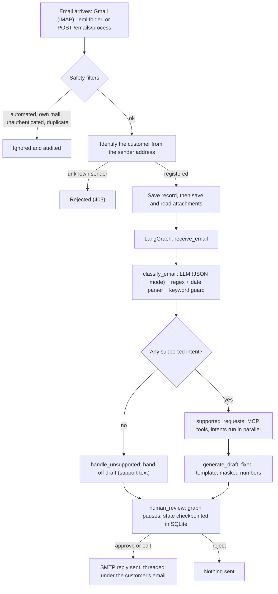

# Design and Decisions

The complete flow of the system, the techniques used at each step, and the decisions behind them: what we chose, what we rejected, and why. Written for engineers and technical reviewers. For the client-facing explanation see [CLIENT_GUIDE.md](CLIENT_GUIDE.md); for API specs and limits see [ARCHITECTURE.md](ARCHITECTURE.md).

**Guiding idea:** use the language model only where it is genuinely good (understanding free text), and use plain, testable code everywhere a wrong answer would cost money or trust (identity, numbers, dates, wording, sending).

---

## 1. The complete flow

### Step by step (with where it lives)

| # | Step | What happens | Code |
|---|---|---|---|
| 1 | **Ingest** | Three entry points feed one function: Gmail over IMAP (`POST /emails/mailbox/poll`, or a background poller), a folder of `.eml` files (`POST /emails/inbox/poll`), or plain text (`POST /emails/process`). | `apis/email_api.py` (`run_email`), `utils/mailbox.py`, `utils/email_reader.py` |
| 2 | **Mailbox safety filters** (Gmail only) | Search only unread mail from the last N days, newest first, optionally only from listed senders (`MAIL_ONLY_FROM`). Skip bounces, no-reply, `Auto-Submitted`/bulk mail and our own address. Require Gmail's own DKIM/SPF pass for the From domain. Skip a `Message-ID` already stored. Mark read afterwards. | `utils/mailbox.py`, `utils/email_reader.py`, `apis/email_api.py` |
| 3 | **Identify the customer** | The sender address is looked up in `customers`. Unknown sender gives 403. The identity never comes from the email text. | `resolve_customer_id` |
| 4 | **Record and attachments** | An `email_records` row is created (sender, subject, Message-ID). Only now, after the sender is verified, attachments are saved under `data/attachments/<id>/` (sanitised names) and read: PDF text with `pypdf`, images with Tesseract OCR. Bad or oversized files are skipped and audited. | `utils/email_reader.py` |
| 5 | **Clean the text** | Quoted replies, "On … wrote:" threads and signatures are dropped; HTML-only mail is stripped to text; the subject is prepended. | `clean_text`, `parse_eml` |
| 6 | **Classify** | One LLM call (Llama 3.2 3B, Ollama JSON mode) returns intents, sentiment, and any dates. Then code takes over: account and card numbers by regex; the statement period by a deterministic parser; transaction count validated (1-10); an intent is kept only if the email contains one of its words. A chatty or malformed model answer is parsed defensively; if parsing fails, the email falls back to "no intents". | `agents/email_agent.py`, `utils/periods.py` |
| 7 | **Route** | No supported intent goes to `handle_unsupported`, which writes a hand-off draft (support wording from `SUPPORT_CONTACT_TEXT`) and **also pauses for human review**, flagged "Needs a person". Otherwise to the tool step. | `route_request` |
| 8 | **Fetch** | A fresh MCP server process is started over stdio. Accounts and cards owned by the customer are discovered first. Then all intents run **in parallel**. Each one resolves its account or card (the number in the email, else the customer's only one, else "not specified"), **validates** it, then calls the data tool. Every call has a 15 s timeout; read-only calls retry once; the statement call never retries. Each failure becomes a customer-safe message, so one failure never blocks the others. | `supported_requests` in `agents/email_workflow.py`, `agents/mcp_server.py` |
| 9 | **Draft** | A fixed template builds the reply from the verified results: greeting with the validated name, sections per intent, Indian digit grouping (`INR 1,25,000.00`), a fixed sentiment line, clear messages for failures, sign-off. Masked a final time. | `utils/reply_builder.py` |
| 10 | **Pause for review** | The graph executes `interrupt()`; state is checkpointed to SQLite, so the review survives restarts. | `human_review` |
| 11 | **Review** | A reviewer uses the console (`/ui`) or the API: approve, edit-and-approve, or reject. The endpoint first checks the saved workflow really is paused, otherwise it answers 409. | `POST /emails/{id}/review`, `ui/index.html` |
| 12 | **Send** | Only on approval: SMTP reply to the recorded sender with `In-Reply-To`/`References` and `Auto-Submitted: auto-replied`. A send failure is recorded as `send_failed` and never undoes the approval. | `_deliver`, `utils/mailbox.py` |
| 13 | **Audit** | Every stage writes a masked JSON line keyed by `email_id`: received, classified, each tool call with timing, timeouts, draft, review, reply sent. | `utils/logging_config.py` |

---

## 2. Techniques used, and why each

| Technique | Where | Why this, here |
|---|---|---|
| **State machine with checkpoints** (LangGraph + SQLite saver) | `agents/email_workflow.py` | Explicit, inspectable steps; the human-review pause must survive a restart. |
| **Tool layer over MCP** | `agents/mcp_server.py`, client in the workflow | The banking functions are a small, typed, allow-listed set. Ownership is checked *inside* each tool, so nothing the model says can bypass it. |
| **Local LLM** (Llama 3.2 3B via Ollama) | `utils/llm_client.py` | Customer email stays on the client's infrastructure; no per-call fees. |
| **JSON-only mode** | `generate_response(json_mode=True)` | Stops the model wrapping its answer in prose; also about 3-4x faster because it writes less. |
| **Defensive JSON parsing** | `identify_intent` | Decode the first valid JSON object, ignoring trailing text and stray braces. |
| **Regex for numbers** | `extract_entities` | Small models are unreliable with digits. Regex is exact and testable. |
| **Deterministic date parsing** | `utils/periods.py` | "April 2026" must always mean 1-30 April 2026. Ambiguity returns "none" so we ask instead of guessing. |
| **Keyword guard on intents** | `INTENT_KEYWORDS` | The model over-reported intents (an unrequested `get_transactions`). An intent needs a matching word in the email. |
| **Template-based reply** | `utils/reply_builder.py` | Facts never pass through the model, so they cannot be invented or garbled. |
| **Defence in depth on identity** | sender lookup, tool ownership checks, DKIM/SPF, token | Each layer assumes the one before it can fail. |
| **Masking by regex** | `utils/logging_config.py` | Last four digits only, applied to logs, audit and replies. UUID-style IDs and money amounts are deliberately left alone. |
| **Parallel fan-out with isolated failures** | `asyncio.gather` per intent | Independent intents run together; one failing never hides the others. |
| **Timeouts, and retries only where safe** | `TOOL_TIMEOUT_SECONDS`, `NEVER_RETRY` | A hung service must not hang a request. A write must never be repeated blindly. |
| **Idempotency** | `Message-ID` stored per record | Re-polling cannot process a message twice. |
| **Untrusted-text rendering** | `ui/index.html` | Customer text is shown with `textContent` only; a test fails the build if `innerHTML` appears. |
| **Configuration by environment** | `.env`, `DATA_DIR` | Same image everywhere; tests and Docker use separate data folders. |

---

## 3. Decision log

Format: **decision**, why, what we rejected, the trade-off we accepted.

### Model and AI

| # | Decision | Why | Rejected | Trade-off |
|---|---|---|---|---|
| D1 | **Local Llama via Ollama** | Bank data stays on-premises; no per-email cost; matches the brief's Llama suggestion. | A hosted API (more accurate, simpler, but customer email leaves the building). | Lower accuracy and slower responses on CPU. Mitigated by code around the model (D3, D4, D5). |
| D2 | **Moved from Llama 3.2 1B to 3B** | The 1B model added intents nobody asked for and mishandled the reply wording. | Staying on 1B. | Larger download (about 2 GB) and more RAM (about 4 GB). Model name is the `OLLAMA_MODEL` setting, so it can be changed without code. |
| D3 | **The model classifies only; a template writes the reply** | The 1B model once greeted a customer with their masked account number as their name. Replies contain figures; they must be exact. | Letting the model draft the email (more natural wording). | Replies sound the same every time. An optional model-written opening line is a possible extra. |
| D4 | **Account/card numbers by regex, dates by a parser, intents guarded by keywords** | Use the model for meaning, code for anything exact. Each rule is unit-tested. | Asking the model to extract everything. | Phrases the rules do not know are not understood (the customer is asked instead). |
| D5 | **When unsure, ask the customer** | Guessing a statement period or an account is worse than a polite question. | Defaulting to "last 30 days" or the first account. | An extra round trip for vague emails. |

### Architecture

| # | Decision | Why | Rejected | Trade-off |
|---|---|---|---|---|
| D6 | **LangGraph state machine** | Deterministic, auditable flow with a built-in pause (`interrupt`) and checkpointing. | CrewAI-style free-roaming agents (less predictable); a plain script (no durable pause). | The "agents" in the brief are graph nodes and functions, not autonomous agents. We chose predictability. |
| D7 | **MCP tool layer, one server process per email** | A narrow, typed boundary between the AI side and banking data; ownership enforced inside the tools. | Calling the database or REST API directly from the workflow. | Process start-up per email; fine at pilot volume, to be pooled later. |
| D8 | **Human review is mandatory before sending** | Cannot undo a sent email to a customer; accuracy is not yet measured. | Auto-send for "easy" intents. | Humans are the throughput limit. Auto-send for low-risk cases is a later, measured decision. |
| D9 | **Identity from the sender address, never the body** | Anyone can type any account number in an email. | Trusting the account number or name in the text. | Customers must write from their registered address. |
| D10 | **Intents run in parallel; validate before fetch inside each** | Independent requests should not wait on each other; an invalid number must never reach a data call. | Sequential loop. | Slightly more complex error handling (each intent returns its own result). |
| D11 | **Timeouts everywhere; retry reads once; never retry the statement write** | A retried write could create a duplicate request. | Retrying everything; no timeouts. | A transient failure on a statement request needs a human retry. |
| D12 | **SQLite for banking, emails and checkpoints** | Zero set-up, enough for a prototype and tests. `DATA_DIR` moves it. | PostgreSQL/MongoDB (suggested in the brief). | Single-writer limits scale. The database layer is small and isolated, so a swap is contained. |
| D13 | **REST mock banking API *and* MCP tools over the same data** | The REST API documents the contract (matches the brief's sample); the tools are what the agent really uses. | One of the two. | Two code paths to keep in step; both are tested. |

### Mailbox and security

| # | Decision | Why | Rejected | Trade-off |
|---|---|---|---|---|
| D14 | **Real Gmail over IMAP/SMTP with an App Password** | Simple, works with any account that has 2-Step Verification, demonstrates the real loop. | OAuth (more robust, much more set-up); webhooks/IMAP IDLE (push). | Interval polling; App Password is as powerful as the mailbox. Documented limits. |
| D15 | **Trust only Gmail's own DKIM/SPF verdict, for the same domain as From** | The From header is trivially forged. | Trusting From; trusting any Authentication-Results header (which a sender can add). | Gmail-specific; another provider needs its own server name checked. |
| D16 | **Protect the real inbox**: unread only, last N days, newest first, optional sender allow-list, `BODY.PEEK` | The first test mailbox had 42,000 unread messages. The poller must not touch a backlog. | Fetching all unread mail, oldest first. | Mail older than N days is ignored by design. |
| D17 | **Mark mail read after one attempt, even if it failed** | One poison message must not be retried forever. | Leaving failures unread. | A failed email needs resubmitting; the failure is in the audit log. |
| D18 | **Skip automated mail and mark our replies `Auto-Submitted`** | Prevents reply loops between auto-responders. | Replying to everything. | A real customer with an auto-reply header is ignored. |
| D19 | **One shared reviewer token on `/emails/*`** | Approving sends real email; any protection beats none. | User accounts/SSO (right answer for production, too much for a prototype). | No per-reviewer identity in the audit trail. The API is open if the token is unset, and the server warns at startup. |
| D20 | **Mask to the last four digits in logs, audit and replies** | Auditability must not become a data leak. | Logging raw values. | The stored email text is still raw (reviewers need it). |

### Delivery

| # | Decision | Why | Rejected | Trade-off |
|---|---|---|---|---|
| D21 | **Docker Compose with an Ollama service and a one-shot model pull** | One command brings up everything; the model downloads itself. Data lives in a named volume. | Asking users to install Ollama and pull models by hand. | First start downloads about 2 GB. |
| D22 | **Reviewer console is one static HTML file** | No build tool, no dependencies, ships with the API, easy to audit. | React/Vue single-page app. | Fewer niceties; fine for a review queue. |
| D23 | **Tests fake the LLM, IMAP and SMTP, and use throw-away databases** | Fast, repeatable, and they can never touch real data or credentials. | Tests that call real services. | Real-model accuracy is *not* covered by the suite (see section 7). |
| D24 | **A simulated mailbox of `.eml` files alongside real Gmail** | Demos and tests without credentials; the same parsing code path. | Only real Gmail. | None significant. |
| D25 | **Requests we cannot complete go to the review queue as "Needs a person", never silently dropped and never auto-answered** | A customer must not hear nothing, and an auto-reply would break the approve-before-send rule. A change of address is a fraud step and must not be done on an email's say-so. | Ignoring them; an automatic acknowledgement; implementing profile changes by email. | A person must handle each one. The wording the customer sees is the client's own (`SUPPORT_CONTACT_TEXT`). |
| D26 | **Fraud, lost-card or dispute wording forces "urgent" and clears the intents (hand-off)** | These are the emails that most need a person quickly, and answering one with a transactions table is wrong (the real model tagged a fraud report `get_transactions`). | Relying on the model's sentiment or intent alone (it also fails when the model is down). | A short word list: it can over-flag ("dispute" in an unrelated sentence) but never under-flags what it lists. |

---

## 4. What happens when something fails

| Failure | Behaviour |
|---|---|
| Sender unknown or unauthenticated | Not processed; audited (`mail_rejected`) or 403. |
| Automated mail, own mail, duplicate | Skipped; audited. |
| LLM down or returns garbage | No intents; no banking call is made. The email goes to the review queue flagged "Needs a person", with the error shown, and a hand-off draft. |
| Number invalid or not the customer's | That intent returns "please recheck"; the others still succeed (partial success). |
| Detail missing (account, card, period) | That intent asks the customer for it. |
| Banking tool slow | Time out after 15 s, retry reads once, then a customer-safe "did not respond in time". |
| Attachment corrupt, oversized or unsupported | Skipped and audited; the email still processes. |
| Draft building fails | The hand-off draft and an error note. |
| Sending fails | Approval stands; `delivery_status = send_failed`; error toast in the console. |
| Review of an email without saved workflow state | 409, nothing overwritten. |
| Two polls at once | A lock serialises them. |

---

## 5. Data model

- **`banking.db`**: `customers` (id, name, email), `accounts`, `cards` (masked number), `transactions`, `statement_requests`. Seeded demo customer `CUST001`.
- **`email.db`**: `email_records`: one row per email: text, sender, subject, `message_id`, status, intents, sentiment, tool results, draft, errors, approval status, reviewer feedback, `delivery_status`, timestamps. Older databases are migrated automatically on start.
- **`email_checkpoints.db`**: LangGraph's saved graph state, which is what makes "resume after review" work.
- **Workflow state** (`models/email_state.py`): `email_text`, `attachment_text`, `intents`, `sentiment`, `entities`, `tool_results`, `draft`, `errors`, `status`, `approval_status`, `reviewer_feedback`, `sender_email`, `verified_customer_id`, `customer_name`.
- **Files**: `data/attachments/<email_id>/` (originals), `logs/app.log`, `logs/audit.log`.

---

## 6. What building it taught us

Real defects found by testing, and what changed. They explain several decisions above.

| What happened | Cause | Change |
|---|---|---|
| A draft greeted the customer "Dear XXXX7890" | The small model used the masked account number as a name | Template reply; name comes from the validation tool (D3) |
| A balance-only email also fetched card transactions | The model over-reported intents | Keyword guard (D4) |
| A statement request returned "period not specified" for "April 2026" | The model did not produce dates | Deterministic date parser (D4) |
| A valid request fell back to "unsupported" on some runs | The model wrapped its JSON in prose containing braces; our greedy regex broke | JSON-only mode plus first-object decoding |
| Audit `email_id`s were sometimes altered | The masking regex hit digit runs inside UUIDs | Mask standalone numbers only |
| A repeated test run failed with a count of 6, not 2 | The audit log grows across runs and the test reused one ID | Fresh IDs per run |
| Real inbox had 42,784 unread messages | The poller took the oldest unread first | Recent-only, newest-first, allow-list (D16) |
| New test emails "did not appear" in the poll | They came from a different address than the registered customer | The poll response now explains empty results |
| Reviewing an email with no saved workflow silently re-ran it and overwrote the record | `resume` on an unknown thread starts a new run | 409 guard before resuming a review |
| Tests started failing after we registered a real customer | Tests shared the developer's database and read the real `.env` | Throw-away databases, mail settings cleared per test |
| Pasting a different email link in the same tab showed the old email | The page ignored hash changes | `hashchange` handler |

---

## 7. Testing

- **87 automated tests** (at the time of writing), with the LLM, IMAP and SMTP faked and temporary databases: parser cases (including ambiguous and tricky ones), reply template, masking, validation and partial failure, timeouts and retries, review flow, mailbox safety rules, token protection, the XSS guard on the console.
- **Browser test of the console** (driven Edge: desktop, phone width, dark mode, a hostile email whose HTML and script must show as plain text).
- **Live runs** against the real 3B model, real Gmail and the Docker stack.
- **Not covered:** *accuracy on real customer email.* The suite proves the logic is right given a model answer; it does not measure how often the model's answer is right. That needs a labelled set of real emails (see the pilot plan in the client guide).

---

## 8. Known gaps and next steps

| Gap | Impact | Suggested next step |
|---|---|---|
| Banking data is mock | Not usable with real accounts | Point the MCP tools at the core banking APIs |
| Accuracy not measured | No number to quote | Label a few hundred real emails; measure intent/entity accuracy |
| SQLite, one process | Pilot scale only | PostgreSQL, a work queue, several workers |
| One shared token | No per-reviewer audit | SSO/user accounts, record the approver |
| Interval polling, Gmail App Password | Latency, broad credential | IMAP IDLE or webhooks; OAuth |
| MCP server spawned per email | Start-up cost | Long-lived server or pool |
| Scanned PDFs, other languages, HTML replies | Narrower coverage | OCR on PDF pages; multilingual model; templates |
| Unused packages in `pyproject.toml` (langchain, pandas, psycopg2, faker, …) | Larger image, confusing | Remove and regenerate `requirements.txt` |
| Quarter / financial-year / "last N months" statement periods | Customer is asked instead | Extend `utils/periods.py` |
| Confidence scoring, RAG policy lookup, monitoring dashboard | Optional items from the brief | After the pilot |

---

## 9. How to extend

**Add a new request type** (for example "cheque book request"):
1. **Tool:** add the lookup or action to `agents/mcp_server.py`, with the ownership check inside it.
2. **Intent:** add its name to `ALLOWED_INTENTS` and a keyword rule to `INTENT_KEYWORDS` in `agents/email_agent.py`, and describe it in the classifier prompt. Add it to the allow-list in `route_request`.
3. **Workflow:** add a branch in `supported_requests` (resolve inputs, validate, call the tool).
4. **Reply:** add a title in `SECTION_TITLES` and a block in `_section` in `utils/reply_builder.py`.
5. **Console:** add a friendly label in the `INTENTS` map in `ui/index.html`.
6. **Tests:** parser/keyword cases, a tool test, and a reply test.

**Change the model:** set `OLLAMA_MODEL` (Docker pulls it; locally `ollama pull <model>`). Nothing else changes; re-run the labelled accuracy set.

**Connect real banking:** replace the SQLite reads inside the MCP tools with calls to your APIs. Keep the ownership checks and the `{"error": ...}` / `VALID` / `INVALID` return shapes, and the workflow, reply and console need no changes.

**Move to a production database:** `utils/database.py` and `utils/email_database.py` are the only SQL entry points; replace the connection and keep the queries.

---

## 10. Where we deliberately differ from the suggested stack

| Suggested in the brief | What we used | Why |
|---|---|---|
| LangChain / LlamaIndex | Direct Ollama client | Only one prompt is needed; a framework would add weight with no benefit. |
| CrewAI / LangGraph | LangGraph | Chosen for a deterministic flow and the review pause (D6). |
| Llama 3 | Llama 3.2 3B | Smallest model that behaved acceptably on CPU. |
| FAISS vector store (optional) | None | No retrieval need yet; relevant only if policy look-up (RAG) is added. |
| PostgreSQL / MongoDB | SQLite | Prototype simplicity (D12). |
| IMAP / SMTP | IMAP / SMTP (Gmail) | As suggested. |
| Docker | Docker Compose | As suggested. |
| Separate agents (understanding, sentiment, entities, validation, selection, response, audit) | Graph nodes and functions in one workflow | Same responsibilities, fewer moving parts; the agent roles map to functions (D6). |
